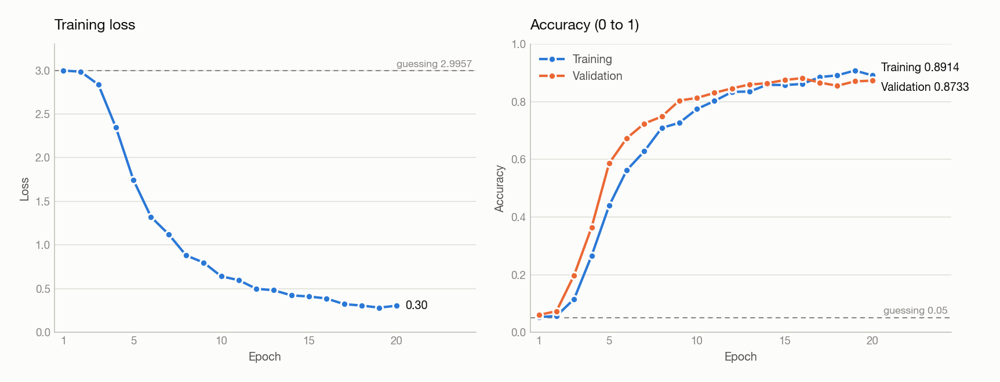

# Lip reading with a 3D-CNN (PyTorch)

A 3D convolutional network that classifies short lip-movement clips into 20 classes: 10 words and 10 phrases. A 3D convolution slides across the frames as well as across the picture, so it can see motion, which a single frame does not contain. The design follows book chapter 7.3, "Visual Speech Recognition using 3D-CNN"; the differences from the book's model are listed under Setup.

All accuracies below are numbers from 0 to 1. Guessing at random among 20 classes gets 0.05.

## Setup

- Data: MIRACL-VC1, 15 speakers x 20 classes (10 words + 10 phrases) x 10 repetitions = 3,000 clips. Only the color frames are used (each folder also holds depth images, which are skipped). The dataset is not in this repo (`dataset/` is git-ignored).
- Clip lengths: a clip has between 4 and 27 color frames (34,762 frames in all). The most common length is 10 frames (383 clips); 173 clips have exactly 15; 2,475 have fewer; 352 have more.
- Preprocessing: every clip is made exactly 15 frames long. Longer clips keep 15 evenly spaced frames (`np.linspace`). Shorter clips repeat their last frame. Each frame is cropped to a 200 x 125 box around the speaker's mouth (one hand-picked centre per speaker, in `mouth_center`), turned gray, resized to 48 wide x 30 tall, and divided by 255. One clip is an array of shape `(15, 30, 48)`.
- Split: 70% / 15% / 15%, stratified by class (`random_state=42`): 2,100 clips for training, 450 for validation, 450 for the final test. Every class appears in all three parts.
- Model: 3 blocks of `Conv3d` (3x3x3 kernel, padding 1, 32 / 64 / 128 filters, ReLU) each followed by max pooling (`(1, 2, 2)`, then 2, then 2), then flatten (6,912 values), Linear 256, ReLU, Dropout 0.5, Linear 20. 2,052,436 parameters. Compared with the book: 20 classes instead of 10, twice the filters, padding in the convolutions, one 256-unit layer plus dropout instead of the three Dense layers.
- Training: Adam (learning rate 0.001), cross-entropy loss, batch size 16, 20 epochs. The reported run used `torch.manual_seed(0)`; `model2.py` itself sets no torch seed (only `random_state=42` for the split).
- **Pixel scaling.** The reported run also standardized the pixels, `(pixel - 0.457) / 0.273` (the training mean and standard deviation, rounded), applied to the train, validation and test clips. **`model2.py` does not contain this step yet.** Without it the model stays at chance (see below), so `python3 model2.py` as it is now will not reproduce the results.

## Results

One run (seed 0), 20 epochs. The reported numbers come from a scratch script that reuses the data code and the model class of `model2.py`, adds the pixel scaling, and trains with the settings above. That script is not saved in this repo. Test accuracy is on the 450 clips the model never trained on.

| Model | Train acc | Val acc | Test acc | Final train loss |
|---|---|---|---|---|
| After epoch 20 (last) | 0.9795 | 0.8733 | 0.8978 | 0.3045 |
| Epoch 16 (best validation) | 0.9790 | 0.8822 | 0.9156 | 0.3865 |



- The epoch 16 model was picked by validation accuracy, not by test accuracy, so its test number is not inflated by the choice. Its validation number is, a little.
- With 450 test clips, one standard error at accuracy 0.90 is about 0.014, so the two test numbers above (0.018 apart) cannot be told apart. "About 0.90" is the honest summary.
- "Train acc" in the table is measured with dropout off, on all 2,100 training clips. The training accuracy in the chart is measured during training with dropout on, so it is lower (0.8914 at epoch 20). "Final train loss" is also the during-training value.
- Validation loss and test loss were not recorded, so the loss chart shows training loss only. `training_log.csv` (epoch, training loss, training accuracy, validation accuracy) was copied from the run's printed output by hand; `model2.py` does not write it.

What the run shows:

- The loss starts at 2.998, which is `ln(20) = 2.9957`, the loss of a model that gives every class probability 0.05. Accuracy stays at 0.05 to 0.07 for two epochs, then the model starts learning at epoch 3 (loss 2.84, validation 0.1978) and improves fast until epoch 6 (loss 1.32, validation 0.6733).
- Validation accuracy reaches 0.8600 at epoch 13, then stays between 0.8556 and 0.8822 for the rest of the run. Its highest value is epoch 16.
- Training loss keeps falling (0.28 at epoch 19), so the model keeps fitting the training clips while validation stops improving. That gap (0.9795 train against 0.8733 validation, dropout off) is overfitting.

How it got from chance to learning (all with the same model; 3-epoch tests are validation accuracy after 3 epochs):

| Experiment | Result |
|---|---|
| Whole 640 x 480 frame shrunk to 48 x 30 | Stuck at chance for 20 epochs (validation 0.0511, test 0.0489, loss 2.996). The mouth was 1 to 2 pixels wide. |
| Mouth crop, pixels only divided by 255 | Still at chance after 6 epochs (validation 0.0511, loss 2.9967). |
| Overfit test: only 64 training clips, 40 epochs | Loss fell from 3.21 to 1.72, accuracy on those clips reached 0.594. The model and training loop work. |
| Mouth crop + learning rate 0.0003 | Chance after 3 epochs (0.0511). |
| Mouth crop + BatchNorm after each convolution | 0.0800 after 3 epochs. |
| **Mouth crop + scaled pixels** | **0.1978 after 3 epochs, then the 20-epoch run above.** |

Scaling the pixels without the crop was not tried, so these runs do not show whether the crop was needed.

What it does not show:

- **The split is by clip, so the same 15 speakers appear in training, validation and test.** The model may partly learn speakers, not only lip movement. How it does on a speaker it has never seen was not measured; holding out whole speakers is the test to run next.
- This is a single run. How much the accuracy changes from seed to seed was not measured.
- The mouth boxes were picked by eye from one frame per speaker. I checked them on 3 recordings per speaker (45 crops): the mouth was inside the box in all three for 13 of the 15 speakers; for F09 it was missed in one recording and for F04 it was partly cut off in one. Recordings where a speaker moves further were not checked, and the other 2,955 clips were not inspected.
- `make_boxes.py` and `mouth_boxes.json` (face-detector boxes) are in the repo but `model2.py` does not use them. I did not run or evaluate them, and `make_boxes.py` calls `cv2.CascadeClassifier`, which the OpenCV 5.0.0 installed here does not have.
- No per-class accuracy or confusion matrix was computed, so which words and phrases get mixed up is unknown.
- Short clips are padded by repeating the last frame, not with each speaker's `dummy.jpg` closed-mouth image as in the book. Not compared.

## Run it

From the project folder:

```
python3 model2.py
```

The dataset must be in `dataset/`, with one folder per speaker (`F01`, `F02`, ... `M08`), each holding `words/01` to `words/10` and `phrases/01` to `phrases/10`, then repetitions `01` to `10`, then `color_NNN.jpg` frames. `dataset/calib.txt` is a file, not a speaker, and is skipped. The word ids 01 to 10, as listed in the MIRACL-VC1 description, are: begin, choose, connection, navigation, next, previous, start, stop, hello, web (I did not check this order against the videos). Check the original MIRACL-VC1 terms before reusing the data.

`model2.py` prints training and validation accuracy after every epoch and the test accuracy at the end. It does not save the trained model. The `.pth` files in the folder were saved by an earlier script, not by `model2.py`.

Reading the 3,000 clips takes about 4 minutes the first time and about 1 minute when the files are already cached by the operating system. One epoch takes about 45 seconds on the CPU when nothing else is running (up to about 2 minutes when the CPU is busy). `model2.py` picks CUDA if there is one, otherwise the CPU; it does not use the Apple GPU.

To redraw the charts from `training_log.csv`:

```
python3 plot_charts.py
```

Tested with Python 3.13.5, PyTorch 2.9.1, NumPy 2.1.3, OpenCV 5.0.0 (headless), scikit-learn 1.6.1 and Matplotlib 3.10.0, on macOS.
